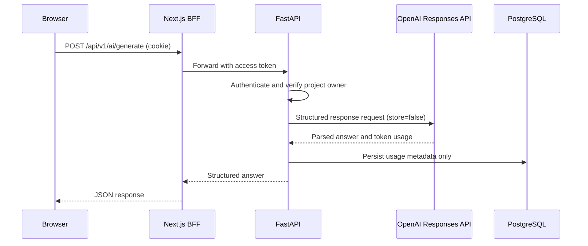
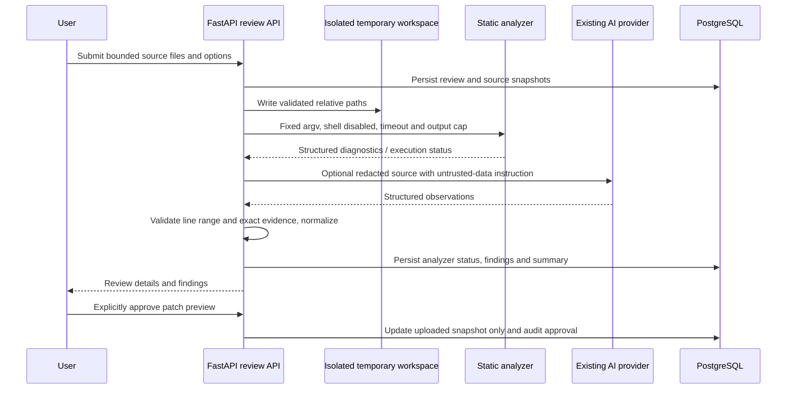
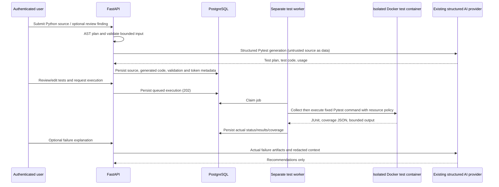

# Architecture

The browser communicates with Next.js same-origin routes. The frontend BFF stores backend tokens in HttpOnly cookies and proxies requests to FastAPI. FastAPI authenticates the user, verifies project ownership, calls the provider abstraction, and records usage metadata through SQLAlchemy. Alembic owns schema evolution; PostgreSQL is the production database.

The OpenAI implementation conforms to the provider interface. Provider errors are normalized to safe structured errors; logs contain request metadata and exception class, not prompt content, API keys, or provider error bodies. Missing configuration is exposed in status and reported on generation. Cost estimates are calculated only from explicitly configured model pricing; they are not billing records.

## Code review flow

The backend analyzer registry maps language to fixed tools. Tool execution never invokes submitted code. Temporary workspaces isolate files from the application checkout, but the current subprocess implementation does not provide OS-level network, memory, or CPU sandboxing; production deployments should run analyzers in a restricted worker/container. Review source snapshots are retained in the database to support safe patch preview/application and are removed when their review is deleted.

## Test-generation and execution flow

Execution queue and sandbox controls are described in [sandbox architecture](sandbox-architecture.md) and [execution security](execution-security.md). Python/Pytest is the only enabled framework. Docker was not installed during this run: the worker therefore reports an infrastructure failure and does not execute submitted code on the host. Network/CPU/memory isolation is not live-verified here.
