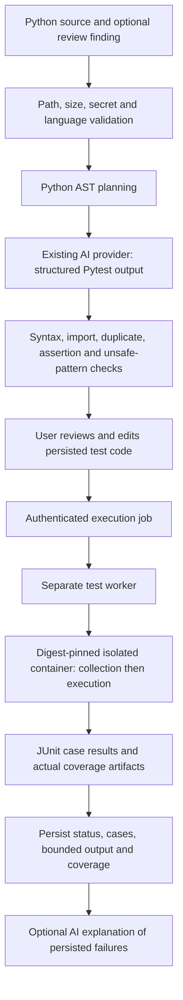

# Automated test generation

Phase 5 currently supports **Python + Pytest**. JavaScript, TypeScript, Java, C, and C++ are reported unsupported for generation/execution; the framework registry is the extension point. The system does not silently select another framework.

## Workflow



The AST planner extracts public functions/methods, parameters, and simple control-flow/raise cues. It selects requested normal, boundary, negative, exception, and linked-regression cases only when the source structure suggests relevance. This is a heuristic plan, not inferred documentation. AI plan targets are checked against the AST plan. The model receives source and review context encoded as data and explicit untrusted-input instructions; provider/token accounting uses the Phase 3 provider and `ai_usage` table.

Generated code is syntax checked and checked for target-module imports, discovered `test_` functions, duplicate bodies/names, tautological assertions, subprocess/dynamic execution, and obvious network APIs. These are static checks, not a security boundary. Pytest collection also imports project modules and therefore happens only inside the isolated worker container. Empty discovery or collection errors stop before test execution. User edits are revalidated.

## Example

For `math_ops.py`:

```python
def add(left, right):
    return left + right
```

A valid structured test response can include a plan for `add` in the `normal` category and:

```python
import math_ops

def test_adds_two_numbers():
    assert math_ops.add(2, 3) == 5
```

The API does not claim this passed. It is marked passed only after the worker returns a parsed JUnit testcase from actual execution. AI output is variable; this example documents the response shape, not a fabricated recorded result.

## Execution and coverage

`POST /api/v1/tests/{generation_id}/execute` writes a queued record with immutable test-code snapshot and source/test hashes, then returns immediately. Duplicate submissions return the existing active execution; a partial unique index protects concurrent requests. The worker verifies both source hashes and the configured image repository digest before running. Run the independent worker with `python -m app.test_generation.worker` from `backend/`. If Docker is absent or the image is not digest-pinned/configured, the worker persists `infrastructure_failure`, with zero tests and an explanatory message. It does not execute the test on the host. Configure `TEST_SANDBOX_IMAGE` to the immutable repository digest of the image built from `infra/test-sandbox-python/Dockerfile`. That image includes pinned Pytest and pytest-cov; no submitted dependency installation or network access is provided.

Pytest writes JUnit XML and coverage.py JSON with branch measurement enabled. The worker derives counts, durations, failure names/tracebacks, total and file-level line/branch coverage when available, and uncovered lines solely from these artifacts. The bounded raw coverage JSON is retained on the execution and available through the owner's `GET /tests/executions/{execution_id}/coverage/raw` endpoint for comparison. Null coverage means unavailable. It never infers zero or success from missing output.

The authenticated `GET /api/v1/tests/executions/{execution_id}/events` endpoint exposes the owning user's sanitized lifecycle audit: queue, worker claim, cancellation request, container/image digest, cleanup confirmation, and recovery events. It does not include submitted source or test contents. Live Docker and PostgreSQL checks are defined in `.github/workflows/sandbox-verification.yml`; those checks are not evidence until that workflow has run successfully.

AI failure analysis requires persisted failed/error test cases and uses their actual test names, assertion output and traceback with redacted source/test context. Recommendations are saved and labeled as unverified; AI cannot alter execution status.
